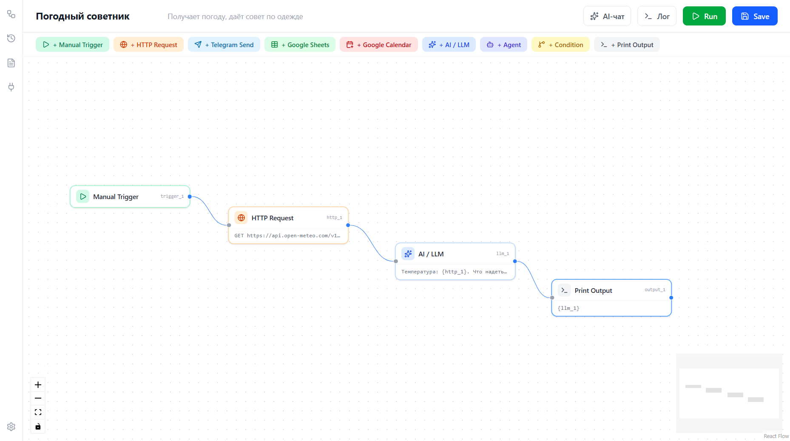

# FlowMind AI

**Визуальный конструктор AI-агентов и автоматизаций** — как сервис в облаке (регистрация, тарифы, оплата) и как self-hosted версия с локальными моделями.



## Содержание

1. [О сервисе](#о-сервисе)
2. [Возможности](#возможности)
3. [Два режима: облако и локально](#два-режима-облако-и-локально)
4. [Как работать с сервисом на сайте](#как-работать-с-сервисом-на-сайте)
5. [Тарифы и оплата](#тарифы-и-оплата)
6. [Локальный запуск с локальными нейронками](#локальный-запуск-с-локальными-нейронками)
7. [Запуск в облаке](#запуск-в-облаке)
8. [Подключение реальной оплаты (ЮKassa)](#подключение-реальной-оплаты-юkassa)
9. [Настройка подключений](#настройка-подключений)
10. [Админ-панель](#админ-панель)
11. [Безопасность](#безопасность)
12. [Конфигурация (переменные окружения)](#конфигурация-переменные-окружения)
13. [Разработка и тесты](#разработка-и-тесты)
14. [Ограничения](#ограничения)
15. [Структура проекта](#структура-проекта)

---

## О сервисе

FlowMind AI — no-code редактор для сборки AI-агентов и автоматизаций на визуальном графе (canvas), вдохновлённый n8n, но построенный вокруг агента: он **сам решает**, какой инструмент вызвать и когда остановиться (полноценный tool calling), а не просто выполняет цепочку шагов.

Один и тот же код работает двумя способами:

- **Облачный сервис** — регистрация, тарифы Бесплатно / Про / Бизнес, оплата подпиской, личный кабинет, админ-панель, лендинг.
- **Локально (self-hosted)** — без регистрации и лимитов, модели [Ollama](https://ollama.com) на вашем компьютере, данные не покидают его.

Для кого: малый и средний бизнес (поддержка клиентов, заявки, планирование встреч) и технические пользователи, которым важен self-hosting.

## Возможности

- **Агент с tool calling.** Любая нода может стать инструментом агента — достаточно заполнить `tool_name` / `tool_description`. Работает на Ollama, на OpenAI-совместимых API и на Hugging Face.
- **Визуальный редактор** (React Flow): порядок выполнения определяют связи графа (топологическая сортировка), инструменты агента подключаются отдельными связями.
- **Ноды:** Manual Trigger, **Telegram Trigger**, LLM, Agent, HTTP Request, Condition, Print, Telegram Send, Google Sheets (добавление строки), Google Calendar (создание события).
- **Telegram-триггер.** Сценарий запускается входящим сообщением боту; `Telegram Send` с пустым `chat_id` отвечает в тот же чат. Доступны переменные `{input}`, `{telegram_chat_id}`, `{telegram_username}`, `{telegram_first_name}`. В облаке — через webhook, локально — через long polling.
- **AI-чат в редакторе.** Опишите сценарий словами («Telegram-бот поддержки с агентом, который ищет заказ по HTTP») — ассистент соберёт или изменит граф; вы нажимаете «Применить к холсту», проверяете и сохраняете. Также отвечает на вопросы по работе сервиса.
- **Подключения** с шифрованием секретов (API-ключи, токены ботов, Google-токены) и маскировкой в интерфейсе.
- **История выполнений** с читаемым чат-логом: диалог агента и вызовы инструментов.
- **Шаблоны** готовых сценариев, **настройки по умолчанию** (хранятся в вашем аккаунте).
- **Аккаунты:** регистрация, вход, сброс пароля, подтверждение email (опционально), личный кабинет.
- **Подписки:** три тарифа, помесячная и годовая оплата со скидкой 20%, апгрейд с зачётом остатка, отложенное понижение, отмена, автопродление, льготный период при неудачном списании.
- **Оплата:** встроенная имитация для демо (тестовые карты, 3-D Secure, отказы) и готовая интеграция с ЮKassa.
- **Админ-панель:** статистика и выручка, пользователи, ручная выдача тарифов, редактирование тарифов и лимитов, платежи, рубильник и суточный потолок AI-ключа сервиса, журнал действий.
- **Лендинг** с описанием, тарифами и FAQ.

## Два режима: облако и локально

Режим задаётся переменной `DEPLOYMENT_MODE`.

| | `cloud` (сервис) | `local` (у себя) |
|---|---|---|
| Регистрация и вход | да | нет — работает сразу |
| Тарифы и оплата | да | нет — безлимитный «локальный» тариф |
| База данных | PostgreSQL (рекомендуется) | SQLite (файл) |
| Локальные модели (Ollama) | недоступны | да, по умолчанию |
| LLM по умолчанию | AI сервиса (ключ Hugging Face) или свои ключи | Ollama |
| Telegram-триггер | webhook (нужен публичный HTTPS-адрес) | long polling (адрес не нужен) |
| Защита HTTP-ноды от запросов во внутреннюю сеть | включена | выключена |
| Админ-панель, лендинг | да | не показываются |

В локальном режиме данные по-прежнему привязаны к пользователю — это один автоматически созданный «локальный пользователь», поэтому ничего не нужно «отключать» и можно в любой момент перейти на облачный режим.

---

## Как работать с сервисом на сайте

### 1. Регистрация и вход
Откройте главную страницу → **«Начать бесплатно»** → email и пароль (не менее 8 символов). Бесплатный тариф не требует карты. Если выбрали платный тариф на лендинге, после регистрации вы попадёте сразу на оплату. «Забыли пароль?» на странице входа отправит ссылку для сброса. Если администратор включил подтверждение email — сначала перейдите по ссылке из письма.

### 2. Первый сценарий
- **Шаблоны** — выберите готовый сценарий, он появится в списке воркфлоу.
- Или **Новый воркфлоу** → соберите граф вручную → либо откройте **AI-чат** (кнопка в шапке редактора) и опишите задачу словами.

Сборка вручную: Manual Trigger → **Agent** (системный промпт; режим Cloud — по умолчанию используется AI сервиса, либо выберите своё подключение) → ноды-инструменты (**HTTP**, **Telegram Send**, **Google Sheets**, **Google Calendar**) с заполненными `Tool name` / `Tool description` / `Parameters schema` → соедините **нижний разъём** Agent с инструментом (это связь типа `tool`). **Save** → **Run** → в **Логе** видно, как рассуждал агент.

### 3. Подключения
Раздел **Подключения** — свои ключи и сервисы: Hugging Face, OpenAI-совместимый API, Telegram Bot, Google Таблицы/Календарь. Секреты хранятся зашифрованными. [Подробнее](#настройка-подключений).

### 4. Telegram-бот
1. Создайте бота у [@BotFather](https://t.me/BotFather), скопируйте токен.
2. **Подключения → Инструменты → Telegram Bot** → вставьте токен.
3. В редакторе добавьте **Telegram Trigger**, выберите бота, при желании ограничьте `chat_id` или включите «только команды».
4. Добавьте агента / LLM и **Telegram Send** (пустой `chat_id` = ответ в чат отправителя).
5. Сохраните и держите включённым переключатель **«Активен»** в шапке — пока он включён, сообщения боту запускают сценарий. Каждое сообщение считается запуском по тарифу; если лимит исчерпан, бот ответит об этом в чат.

### 5. Тарифы, оплата и личный кабинет
- **Тарифы** (`/pricing`): у каждой карточки свой переключатель «Месяц / Год», цена пересчитывается на месте, показана экономия; все условия тарифа указаны в самой карточке.
- **Оформление** (`/checkout`): сводка, зачёт неиспользованного периода при апгрейде, форма оплаты. В демо-режиме — форма карты с тестовыми картами (нажмите на карту в списке, чтобы подставить). С включённой ЮKassa — переход на её защищённую страницу.
- **Личный кабинет** (`/account`):
  - *Профиль* — имя, смена пароля, удаление аккаунта;
  - *Подписка* — текущий тариф, дата продления, способ оплаты, смена тарифа, отключение/возобновление автопродления;
  - *Платежи* — история;
  - *Использование* — прогресс-бары по лимитам месяца (запуски AI и обычные, сообщения AI-чата) и по ресурсам (воркфлоу, Telegram-триггеры).
- **Демо-инструменты** (только при `PAYMENT_PROVIDER=mock`, на вкладке «Подписка»): «Симулировать автопродление» и «Следующее списание — с ошибкой» — позволяют показать жизненный цикл подписки без ожидания месяца.

### 6. Навигация между презентацией и сервисом
- **Презентация:** главная `/` (для гостей), `/about` (то же самое, доступно и вошедшим) и `/pricing`. Шапка этих страниц: «Возможности», «Тарифы», «FAQ» (якоря прокручивают страницу без перезагрузки), «Войти» / «Начать бесплатно», а у вошедшего — «Личный кабинет» и «Открыть приложение»; на телефоне — меню-«гамбургер».
- **Сервис:** вошедший пользователь на `/` попадает в список воркфлоу. В боковой панели сервиса есть переходы к тарифам (значок карты) и к презентации (значок «i»), а также личный кабинет, настройки, админ-панель (для админов) и выход.
- Закрытые страницы для гостя ведут на вход и после входа возвращают на нужную страницу; страницы входа и регистрации вошедшего пользователя отправляют в приложение. После выхода вы попадаете на главную.

### 7. Лимиты
При достижении лимита действие отклоняется с понятным сообщением и ссылкой на тарифы. Счётчики запусков обнуляются в начале календарного месяца (UTC). После понижения тарифа уже созданные воркфлоу сохраняются и остаются редактируемыми; новые сверх лимита создать нельзя.

---

## Тарифы и оплата

| | Бесплатно | Про | Бизнес |
|---|---|---|---|
| Цена в месяц | 0 ₽ | 990 ₽ | 2 990 ₽ |
| Цена при оплате за год (−20%) | 0 ₽ | 9 504 ₽ (792 ₽/мес) | 28 704 ₽ (2 392 ₽/мес) |
| AI-воркфлоу | 5 | 25 | 100 |
| Обычные воркфлоу (без AI) | 20 | 100 | без лимита |
| AI-запусков в месяц | 300 | 3 000 | 20 000 |
| Обычных запусков в месяц | 3 000 | 30 000 | 200 000 |
| Активных Telegram-триггеров | 1 | 5 | 20 |
| Сообщений AI-чата в месяц | 100 | 1 500 | 10 000 |
| История выполнений | 14 дней | 60 дней | 180 дней |

«AI-воркфлоу» — воркфлоу, в котором есть LLM- или Agent-нода; остальные считаются обычными. Все цифры и цены — начальные значения: **их можно менять в админ-панели без деплоя**. Значения создаются при первом старте и затем не перезаписываются.

**Правила подписки**
- *Апгрейд* (на более высокий тариф или с месячной оплаты на годовую) — применяется сразу; из цены вычитается пропорциональный остаток оплаченного периода (минимум к оплате — 1 ₽).
- *Понижение* — применяется в конце оплаченного периода, доплат нет.
- *Отмена* — отключает автопродление; платные возможности действуют до конца периода, затем — переход на Бесплатный.
- *Неудачное автосписание* — подписка переходит в статус «не удалось списать», доступ сохраняется (льготный период 3 дня), повторные попытки раз в сутки; после 3 неудач — переход на Бесплатный.
- Тариф, выданный администратором вручную, по окончании срока просто возвращается к Бесплатному.

---

## Локальный запуск с локальными нейронками

В локальном режиме регистрации и лимитов нет, всё работает на вашем компьютере.

### Вариант A — Docker (одной командой)

Нужен [Docker](https://docs.docker.com/get-docker/).

```bash
docker compose up --build
```

Откройте <http://localhost:8000>. Compose поднимает три контейнера: приложение, Ollama и одноразовую загрузку модели (`qwen2.5`, несколько ГБ — при первом запуске подождите, пока `ollama-pull` завершится). Порт опубликован только на `127.0.0.1`, потому что в локальном режиме нет авторизации — не открывайте его в сеть.

Настройка — необязательным файлом `.env` рядом с `docker-compose.yml`:

```env
OLLAMA_MODEL=qwen2.5            # любая модель Ollama с поддержкой tool calling
PLATFORM_LLM_API_KEY=hf_...      # если хотите ещё и облачные ноды без своего подключения
GOOGLE_CLIENT_ID=...             # для Google Таблиц/Календаря
GOOGLE_CLIENT_SECRET=...
```

Для видеокарты NVIDIA раскомментируйте блок `deploy` у сервиса `ollama` в `docker-compose.yml`. Данные сохраняются в томах Docker (`flowmind-data`, `ollama-models`).

### Вариант B — без Docker (для разработки)

1. **Ollama:** установите с [ollama.com/download](https://ollama.com/download), затем
   ```bash
   ollama pull qwen2.5
   ollama serve
   ```
2. **Backend** (Python 3.12):
   ```bash
   cd backend
   python3 -m venv venv
   source venv/bin/activate            # Windows: venv\Scripts\activate
   pip install -r requirements.txt
   cp .env.example .env                # по умолчанию уже DEPLOYMENT_MODE=local
   uvicorn app.main:app --reload --port 8000
   ```
   Миграции БД применяются автоматически при старте. Документация API: <http://localhost:8000/api/docs>.
3. **Frontend** (Node.js 22):
   ```bash
   cd frontend
   npm install
   npm run dev
   ```
   Приложение: <http://localhost:5173> (запросы `/api/*` проксируются на backend).

### Что нужно знать о локальном режиме
- В нодах LLM/Agent режим **Local** использует Ollama (`OLLAMA_URL`, `OLLAMA_MODEL`), режим **Cloud** — свои подключения либо ключ из `PLATFORM_LLM_API_KEY`.
- Шаблоны при создании автоматически переключаются на Ollama.
- Telegram-триггер работает через long polling: публичный адрес не нужен. Сообщения, присланные боту, пока сервис был выключен, пропускаются.
- Включить вход и в локальной версии можно переменными `AUTH_ENABLED=true` (например, для домашнего сервера в сети) — тогда работает обычная регистрация.
- **Обновление со старой версии:** существующая БД мигрируется автоматически, ваши воркфлоу, подключения и история достаются локальному пользователю. В `.env` замените адрес Google OAuth на `…/api/oauth/google/callback` (раньше был без `/api`) и обновите его в Google Cloud Console. Старые подключения с открытыми токенами продолжают работать; новые секреты сохраняются зашифрованными.

---

## Запуск в облаке

Облачный режим: `DEPLOYMENT_MODE=cloud`. Образ собирается из корневого `Dockerfile` (фронтенд собирается внутри, backend раздаёт и API, и сайт — один сервис, один домен, без CORS).

### Render (для презентации)

1. Загрузите репозиторий на GitHub.
2. Render → **New → Blueprint** → выберите репозиторий — подхватится `render.yaml` (веб-сервис в Docker + PostgreSQL).
3. Render спросит значения секретных переменных:
   - `ADMIN_EMAIL`, `ADMIN_PASSWORD` — ваш администратор (домен email должен быть настоящим, например `example.com`; зарезервированные `.test`/`.local` не подойдут);
   - `PLATFORM_LLM_API_KEY` — токен Hugging Face для AI сервиса;
   - `SECRET_KEY` и `ENCRYPTION_KEY` сгенерируются автоматически.
4. Адрес сервиса (`https://….onrender.com`) подставляется автоматически: он нужен для вебхуков Telegram и возврата с оплаты.

Особенности бесплатных планов Render, которые стоит учесть перед показом: бесплатный веб-сервис засыпает после периода простоя и просыпается около минуты — откройте сайт заранее; бесплатная PostgreSQL ограничена по сроку жизни — для постоянной работы выберите платный план или внешнюю БД (укажите её в `DATABASE_URL`). Актуальные условия смотрите в документации Render.

В `render.yaml` включён `DEMO_MODE=true` и `PAYMENT_PROVIDER=mock` — это нужно для презентации (ссылки из писем показываются прямо в интерфейсе, оплата имитируется).

### Свой сервер / хостинг организации

Нужен сервер с Docker и домен, направленный на него.

```bash
cp .env.prod.example .env.prod      # заполните DOMAIN, POSTGRES_PASSWORD, SECRET_KEY, ADMIN_*, ...
docker compose -f docker-compose.prod.yml --env-file .env.prod up -d --build
```

Поднимаются приложение, PostgreSQL и Caddy, который сам получает HTTPS-сертификат. Обновление: `git pull` и повторить команду. Резервные копии — дамп тома `pgdata` (`pg_dump`).

### Чек-лист перед реальными пользователями
- [ ] `SECRET_KEY` и `ENCRYPTION_KEY` — длинные случайные, сохранены в надёжном месте (потеря `ENCRYPTION_KEY` делает сохранённые секреты нечитаемыми).
- [ ] `DEMO_MODE=false`.
- [ ] Настроен SMTP (`SMTP_*`) и при желании `REQUIRE_EMAIL_VERIFICATION=true`.
- [ ] `PAYMENT_PROVIDER=yookassa` и заполнены ключи ЮKassa ([инструкция](#подключение-реальной-оплаты-юkassa)).
- [ ] Задан `PLATFORM_LLM_API_KEY` и проверена модель с tool calling; в админ-панели выставлен суточный потолок.
- [ ] Сервис запущен **одним инстансом** (см. [ограничения](#ограничения)).

---

## Подключение реальной оплаты (ЮKassa)

Платежи устроены через интерфейс `PaymentProvider` (`backend/app/payments/`). Для демо работает `MockProvider`; интеграция с ЮKassa написана, но **не проверялась на живом аккаунте** (тесты идут против имитации API) — сначала прогоните её на тестовом магазине.

1. Зарегистрируйте магазин в [ЮKassa](https://yookassa.ru). Для тестов можно использовать тестовый магазин — без договора; для реальных платежей нужен юридический статус (самозанятый / ИП / юрлицо).
2. В `.env` задайте:
   ```env
   PAYMENT_PROVIDER=yookassa
   YOOKASSA_SHOP_ID=...
   YOOKASSA_SECRET_KEY=...
   PUBLIC_BASE_URL=https://ваш-домен
   ```
3. В личном кабинете ЮKassa в настройках уведомлений (HTTP-уведомления) укажите адрес `https://ваш-домен/api/billing/yookassa/webhook` и события `payment.succeeded`, `payment.canceled`. Сервис не доверяет телу уведомления: статус платежа перепроверяется запросом к API ЮKassa.
4. Подписка продлевается автоплатежами по сохранённому способу оплаты (платёж создаётся с `save_payment_method`, продления — по `payment_method_id`). Доступность автоплатежей для вашего магазина уточните в ЮKassa.
5. Если нужны чеки по 54-ФЗ — `YOOKASSA_RECEIPTS=true` (+ `YOOKASSA_VAT_CODE`, `YOOKASSA_TAX_SYSTEM_CODE`); email покупателя подставляется автоматически. Проверьте параметры чека с вашим бухгалтером.
6. Если вебхук не дошёл (например, при локальной отладке), страница возврата с оплаты сама запрашивает статус у ЮKassa. Для локальной отладки вебхуков нужен туннель до публичного HTTPS-адреса.

Чтобы добавить другого провайдера, реализуйте `PaymentProvider` (`create_payment`, `fetch_payment`, `charge_saved`) и добавьте ветку в `get_provider()`.

---

## Настройка подключений

Все внешние сервисы настраиваются на странице **Подключения**.

| Подключение | Что нужно | Где взять |
|---|---|---|
| Hugging Face | API Key | [huggingface.co/settings/tokens](https://huggingface.co/settings/tokens) |
| OpenAI-совместимый | Base URL + API Key | OpenAI, OpenRouter, Groq и т.п. |
| Telegram Bot | Bot Token | [@BotFather](https://t.me/BotFather) |
| Google Таблицы / Календарь | Вход через Google (OAuth2) | требует настройки в Google Cloud Console |

**AI сервиса.** Если в ноде не выбрано своё подключение (режим Cloud), используется ключ платформы: `PLATFORM_LLM_API_KEY` с базовым адресом `PLATFORM_LLM_BASE_URL` (по умолчанию роутер Hugging Face Inference Providers, OpenAI-совместимый). Модель задаёт `PLATFORM_LLM_MODEL` — она должна поддерживать tool calling; выберите подходящую в списке моделей роутера. Ключ платформы защищён: общий суточный потолок запросов и рубильник «AI выключен» в админ-панели, ограничение длины ответа. Бесплатные квоты провайдера ограничены — следите за расходом и условиями провайдера.

**Google OAuth (Таблицы и Календарь)**
1. [console.cloud.google.com](https://console.cloud.google.com) → создайте проект.
2. **APIs & Services → Library** → включите **Google Sheets API** и **Google Calendar API**.
3. **APIs & Services → Google Auth Platform** → мастер настройки (App Information → Audience: **External** → Contact Information) → на вкладке **Audience** добавьте свой аккаунт в **Test users**.
4. **Credentials → Create Credentials → OAuth client ID** → **Web application** → в **Authorized redirect URIs** добавьте:
   - локально: `http://localhost:8000/api/oauth/google/callback`
   - в облаке: `https://ваш-домен/api/oauth/google/callback`
5. Скопируйте **Client ID** и **Client Secret** в `GOOGLE_CLIENT_ID` / `GOOGLE_CLIENT_SECRET`.
6. **Подключения → Инструменты → Google Таблицы / Календарь → Войти через Google.**

---

## Админ-панель

Доступна пользователям с ролью `admin` (иконка щита в боковой панели, `/admin`). Первый администратор создаётся из `ADMIN_EMAIL` + `ADMIN_PASSWORD` при старте (или получает права, если зарегистрируется с этим email).

- **Обзор:** пользователи, платные подписки, MRR, выручка за 30 дней и всего, график запусков за 14 дней (AI / обычные), расход AI-ключа сервиса за сутки.
- **Пользователи:** поиск, карточка (подписка, использование, платежи), блокировка, смена роли, ручная выдача тарифа.
- **Тарифы:** цены, лимиты (пустое значение — без ограничений, `0` — запрещено), список возможностей для карточки. Изменения применяются сразу.
- **Платежи:** все платежи с фильтром по статусу.
- **Система:** рубильник AI сервиса, суточный потолок запросов, журнал действий администраторов.

---

## Безопасность

- Пароли — Argon2; сессия — короткий JWT access-токен + refresh-токен в `httpOnly`-cookie с ротацией и отзывом при выходе, смене и сбросе пароля.
- Ограничение частоты запросов на вход, регистрацию, письма и AI-чат (в памяти процесса).
- Секреты подключений (API-ключи, токены ботов, Google-токены) шифруются (Fernet, ключ — `ENCRYPTION_KEY`); в API возвращаются только в маскированном виде.
- Все данные изолированы по пользователю: чужие воркфлоу, подключения и выполнения недоступны.
- Condition-нода вычисляет выражения безопасным интерпретатором (раньше использовался `eval`).
- В облаке HTTP-нода и пользовательские Base URL не могут обращаться во внутреннюю сеть / loopback / link-local адреса (защита от SSRF); локальные модели Ollama недоступны.
- Ограничения исполнения: время запуска, число нод, число параллельных запусков на пользователя.
- Вебхуки Telegram проверяются секретом; обновления дедуплицируются. OAuth `state` подписан и привязан к пользователю. Данные банковской карты не сохраняются и не логируются (в демо хранится только бренд и последние 4 цифры); при реальной оплате карта вводится на стороне ЮKassa.

---

## Конфигурация (переменные окружения)

Полный список с комментариями — в `backend/.env.example`. Главное:

| Переменная | Назначение |
|---|---|
| `DEPLOYMENT_MODE` | `local` / `cloud` |
| `AUTH_ENABLED` | принудительно включить/выключить вход (по умолчанию: cloud — вкл., local — выкл.) |
| `DATABASE_URL` | SQLite или PostgreSQL (`postgresql://…`, `postgres://…` тоже принимается) |
| `SECRET_KEY`, `ENCRYPTION_KEY` | подпись токенов и шифрование секретов |
| `PUBLIC_BASE_URL` | публичный адрес (вебхуки, возврат с оплаты); на Render берётся автоматически |
| `ADMIN_EMAIL`, `ADMIN_PASSWORD` | администратор |
| `REQUIRE_EMAIL_VERIFICATION`, `SMTP_*` | подтверждение email и отправка писем |
| `DEMO_MODE` | показывать ссылки из писем в ответе API и `/api/docs` — только для демо |
| `PAYMENT_PROVIDER`, `YOOKASSA_*` | оплата |
| `OLLAMA_URL`, `OLLAMA_MODEL` | локальные модели |
| `PLATFORM_LLM_BASE_URL`, `PLATFORM_LLM_API_KEY`, `PLATFORM_LLM_MODEL`, `AI_DAILY_CAP` | AI сервиса |
| `TELEGRAM_MODE` | `auto` / `webhook` / `polling` / `off` |
| `GOOGLE_CLIENT_ID`, `GOOGLE_CLIENT_SECRET`, `GOOGLE_REDIRECT_URI` | Google OAuth |
| `AUTO_MIGRATE` | применять миграции Alembic при старте |

Совместимость со старыми `.env`: `LLM_MODE`, `HF_TOKEN` (= `PLATFORM_LLM_API_KEY`), `HF_MODEL` (= `PLATFORM_LLM_MODEL`) по-прежнему читаются. Если у вас стояла модель Hugging Face старого формата, убедитесь, что она доступна через роутер и поддерживает tool calling.

---

## Разработка и тесты

```bash
cd backend
pip install -r requirements-dev.txt
TEST_MODE=cloud python -m pytest      # облачный режим: авторизация, изоляция, лимиты, оплата, Telegram, AI-чат, админка
TEST_MODE=local python -m pytest      # локальный режим: без входа, безлимит, Ollama, polling
```

Тесты используют временную SQLite и подменяют все внешние HTTP-вызовы (LLM, Telegram, ЮKassa). Миграции применяются через Alembic — так проверяется и сам путь обновления. Для проверки апгрейда старой БД есть тест с флагом `LEGACY_DB` (см. `backend/tests/test_local.py`).

Фронтенд: `cd frontend && npm test` (тесты навигации между презентацией и сервисом) и `npm run build` (проверка типов + сборка). CI (`.github/workflows/ci.yml`) запускает всё это на каждый push.

Миграции: `cd backend && alembic revision --autogenerate -m "описание"`, применение — `alembic upgrade head`.

Тексты новых страниц (вход, тарифы, кабинет, админка, лендинг) вынесены в `frontend/src/i18n/ru.json`. Чтобы добавить английский, создайте `en.json` с теми же ключами и подключите его в `frontend/src/i18n/index.ts`.

## Ограничения

- **Запуски выполняются внутри процесса** (без очереди воркеров) с лимитом времени. Для большой нагрузки понадобится очередь (Redis + воркеры).
- **Один инстанс.** Ограничитель частоты запросов и long polling Telegram работают в памяти процесса; при нескольких инстансах нужен общий стор. Миграции при масштабировании запускайте отдельно (`AUTO_MIGRATE=false`).
- **Нет памяти диалога** между запусками агента (контекст — только текущий запуск).
- **Триггер по расписанию (cron) и входящий webhook-триггер** не реализованы; триггеры: ручной запуск и Telegram.
- Интерфейс только на русском; строки старых страниц редактора (редактор, подключения, шаблоны, история) пока не вынесены в словарь i18n.
- Интеграция с ЮKassa не проверялась на живом аккаунте.
- Google-интеграции требуют ручной настройки OAuth-приложения (ограничение самого Google).
- Docker-файлы (`Dockerfile`, `docker-compose*.yml`, `render.yaml`) не запускались в среде разработки этого релиза — проверьте первый запуск.

## Структура проекта

```
FlowMind-AI/
├── backend/
│   ├── app/
│   │   ├── main.py              # приложение, фоновые задачи, раздача фронтенда
│   │   ├── config.py            # все настройки из окружения
│   │   ├── models.py, schemas.py, security.py, deps.py, seed.py
│   │   ├── worker.py            # движок выполнения workflow (agent-loop, ноды)
│   │   ├── templates.py         # шаблоны сценариев
│   │   ├── routers/             # auth, me, workflows, connections, billing, telegram, ai, admin, system
│   │   ├── services/            # limits, billing, runner, llm, telegram_service, ai_assistant, ssrf, safe_eval, ...
│   │   └── payments/            # PaymentProvider: mock, yookassa
│   ├── db_migrations/           # миграции БД (Alembic)
│   ├── tests/
│   ├── requirements.txt, requirements-dev.txt, .env.example
├── frontend/
│   └── src/
│       ├── api/client.ts        # клиент API (токены, автообновление сессии)
│       ├── store/auth.ts        # конфиг развёртывания, текущий пользователь
│       ├── i18n/                # словарь интерфейса
│       ├── components/          # canvas/, auth/, billing/, common/
│       └── pages/               # Landing, Login, Register, Pricing, Checkout, Account, admin/, WorkflowEditor, ...
├── deploy/Caddyfile
├── Dockerfile                   # фронтенд + backend в одном образе
├── docker-compose.yml           # локально: приложение + Ollama
├── docker-compose.prod.yml      # сервер: приложение + PostgreSQL + Caddy (HTTPS)
├── render.yaml                  # Render Blueprint
├── .env.prod.example
└── docs/
```
