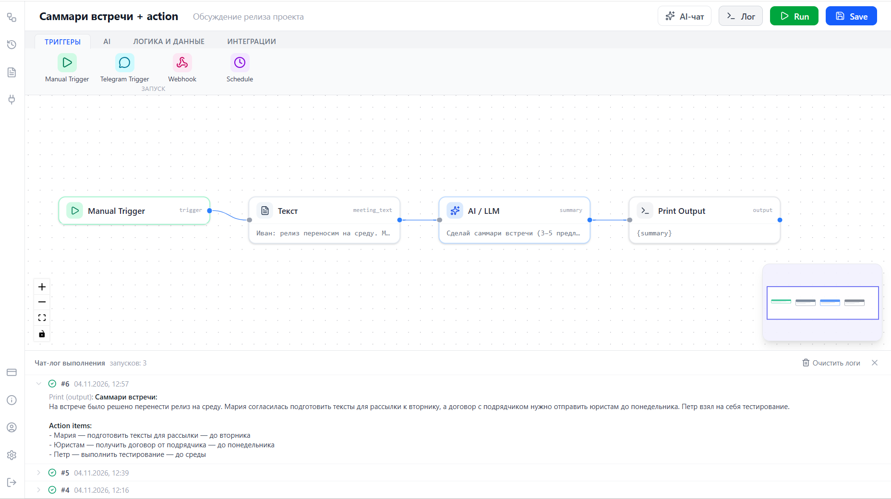

# О FlowMind AI

**FlowMind AI** — конструктор автоматизаций на визуальном холсте. Вы собираете сценарий из шагов: запуск (сообщение в Telegram, письмо, вызов по ссылке, расписание, кнопка), обработка данных, нейросеть, ветвления и действия (ответ клиенту, строка в таблице, событие в календаре). Линии между шагами показывают, в каком порядке и с какими данными выполняется сценарий.

## Для чего это нужно

- **Поддержка клиентов.** Бот в Telegram или ответы на письма: сервис находит в сообщении номер заказа, определяет тему обращения, готовит ответ и отправляет его.
- **Приём заявок.** Заявка с сайта или из письма автоматически попадает в Google Таблицу, а клиенту уходит подтверждение.
- **Рутина.** Краткий итог встречи, отчёт по расписанию, запись клиента в календарь.

## Два режима работы

| | Облачный сервис | Локальная версия (self-hosted) |
|---|---|---|
| Вход | Регистрация, личный кабинет | Без регистрации |
| Тарифы и лимиты | Бесплатно, Про, Бизнес | Без ограничений |
| Нейросеть | Модели платформы или свои ключи (OpenAI-совместимые, Hugging Face и др.) | Локальные модели [Ollama](https://ollama.com) на вашем компьютере |
| Данные | На сервере сервиса | Остаются на вашем компьютере |

Редактор, шаги и документация в обоих режимах одинаковые. Разворачивание описано в разделе [Установка](/admin/installation).

## Как устроена документация

- **[Быстрый старт](/guide/quick-start)** — первый работающий сценарий за несколько минут, без нейросети.
- **[Основные понятия](/guide/concepts)** — шаги, связи, ветки, данные запуска.
- **[Редактор](/guide/editor)**, **[данные между шагами](/guide/data-between-steps)**, **[проверка](/guide/checking)**, **[ИИ-помощник](/guide/ai-assistant)** — как работать на холсте.
- **[Справочник по шагам](/steps/)** — что делает каждый шаг и какие у него настройки.
- **[Установка и настройка](/admin/installation)** — для тех, кто разворачивает сервис сам.

::: tip Совет
Если вы впервые видите конструктор автоматизаций, начните с [быстрого старта](/guide/quick-start) и затем прочитайте [основные понятия](/guide/concepts): вместе это займёт около четверти часа.
:::
